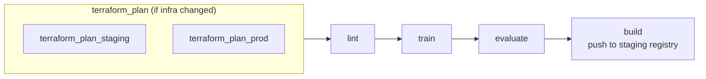

# End-to-End MLOps Pipeline: Spam Classifier

An end-to-end MLOps project that trains, evaluates, containerizes and deploys a spam classifier to Google Cloud Run through a fully automated GitLab CI/CD pipeline, with a staging and a production environment and all cloud infrastructure managed as code using Terraform.

## Table of Contents

* [Introduction](#introduction)
* [Pipeline](#pipeline)
* [Technologies](#technologies)
* [Setup](#setup)
* [Contact](#contact)

## Introduction

This project takes a spam classification model from training to a public prediction API, with every step automated, every release tested in staging before it reaches production, and every piece of infrastructure defined in code.

* **ML pipeline:** GitLab CI lints the code, trains the model on a dataset stored in Google Cloud Storage, evaluates it, versions the trained model in GCS per commit, and builds a Docker image with the model baked in.
* **Staging and production:** Two isolated environments, each in its own Google Cloud project with its own Cloud Run service, Artifact Registry, GCS bucket, service accounts and Terraform state. Every change is deployed and tested in staging first.
* **Build once, promote:** The image is built only once, in staging. After a manual approval, the exact tested image is copied by digest from the staging registry to the production registry and deployed, so production always runs byte for byte what passed in staging.
* **Infrastructure as Code:** All Google Cloud resources (Cloud Run, Artifact Registry, GCS, service accounts, IAM bindings, Workload Identity Federation, enabled APIs, Secret Manager) are defined once in a reusable Terraform module and instantiated per environment. Terraform also writes the values the pipeline needs as GitLab CI/CD variables, scoped per environment, so `.gitlab-ci.yml` contains no hardcoded cloud configuration.
* **Infrastructure changes through the pipeline:** Every branch gets a `terraform plan` for both environments, so infrastructure changes can be reviewed in the merge request. On `main`, staging is applied automatically, and production is applied after the manual approval, together with the release it belongs to.
* **Keyless, least-privilege security:**
  * No service account keys anywhere: GitLab CI authenticates to Google Cloud with short-lived OIDC tokens through Workload Identity Federation.
  * Separate identities per job and environment: a deploy identity for the app, a read-only `terraform-plan` identity usable from any branch, and an admin `terraform-apply` identity that only pipelines on the `main` branch can use.
  * The GitLab token Terraform needs for writing CI/CD variables is stored in Google Secret Manager and readable only by the apply identity.
* **Controlled deployments:** Feature branches run checks only (plans, lint, train, evaluate, build). Only `main` applies infrastructure and deploys, and only after an explicit approval for production.

The deployed API exposes two endpoints:

* `GET /health`: health check
* `POST /predict`: classifies a list of messages, e.g. `{"texts": ["Congratulations! You won a free prize", "Hey, are we still meeting tomorrow?"]}`

## Pipeline

### Merge request / feature branch pipeline

Validates the change without deploying anything. The Terraform plans show what the branch would change in each environment, but nothing is applied, and the plans only run when `infra/` or `.gitlab-ci.yml` changed. The model is trained and the image is built in staging, so the trained model is stored in the staging bucket and the image is pushed to the staging registry, but no Cloud Run service is updated.



### Main branch pipeline (after merge)

Staging runs automatically. Production runs only after a manual approval.

```mermaid
flowchart LR
    subgraph plan["terraform_plan (if infra changed)"]
        PS[terraform_plan_staging]
        PP[terraform_plan_prod]
    end
    plan --> AS[terraform_apply_staging<br/>if infra changed]
    AS --> L[lint] --> T[train] --> E[evaluate] --> B[build<br/>push to staging registry]
    B --> DS[deploy_staging] --> IS[integration_tests_staging]
    IS --> G{{"approve_prod<br/>manual gate"}}
    G --> AP[terraform_apply_prod<br/>if infra changed]
    AP --> PR[promote_image<br/>copy by digest to prod registry]
    PR --> DP[deploy_prod] --> IP[integration_tests_prod]
```



## Technologies

Here's what I used for this project:

* Python: Used for model training, evaluation and the prediction API.
* Ruff: Linter used in the pipeline to keep the code clean.
* Docker: Used to containerize the prediction API, with the trained model baked into the image (built in CI with Docker-in-Docker).
* GitLab CI/CD: Pipeline that automates infrastructure, training, evaluation, build, promotion, deployment and testing, using GitLab environments to target staging and production.
* Terraform: Infrastructure as Code tool used to manage all Google Cloud resources and the GitLab CI/CD variables, with a reusable module, one configuration per environment and remote state in GCS.
* crane: Copies the tested image between the staging and production registries by digest, without rebuilding it.
* Google Cloud Run: Serverless platform hosting the prediction API, scaling from 0 to 20 instances.
* Google Artifact Registry: Stores the Docker images, tagged per commit.
* Google Cloud Storage: Stores the training dataset, the trained models (versioned per commit) and the Terraform state.
* Workload Identity Federation: Lets GitLab CI authenticate to Google Cloud without long-lived keys.
* Google Secret Manager: Stores the GitLab write token used by the Terraform apply jobs.
* IAM: Dedicated service accounts with least-privilege roles for each pipeline job and for the running service.
* GitLab: All project code is stored and versioned in GitLab, and also published on GitHub.

## Setup

To run this project in your own Google Cloud projects and GitLab project, follow these steps.

### Prerequisites

* Two Google Cloud projects with billing enabled, one for staging and one for production, and Owner access to both
* A GitLab project containing a copy of this repository (for example a fork), with the `main` branch protected (the default)
* `gcloud` CLI (preinstalled in Google Cloud Shell)
* Terraform `1.17.x`, the same version the pipeline uses

**Installing Terraform in Google Cloud Shell**

Cloud Shell only keeps your home folder between sessions, so system packages installed by hand are lost on restart. Cloud Shell runs `~/.customize_environment` automatically at the start of every session, so installing Terraform from there keeps it available:

```
cat <<'EOF' > ~/.customize_environment
# Set up the HashiCorp repository and install Terraform (runs at every Cloud Shell start)
wget -qO - https://apt.releases.hashicorp.com/gpg | sudo gpg --yes --dearmor -o /usr/share/keyrings/hashicorp-archive-keyring.gpg
echo "deb [arch=$(dpkg --print-architecture) signed-by=/usr/share/keyrings/hashicorp-archive-keyring.gpg] https://apt.releases.hashicorp.com $(grep -oP '(?<=UBUNTU_CODENAME=).*' /etc/os-release || lsb_release -cs) main" | sudo tee /etc/apt/sources.list.d/hashicorp.list
sudo apt-get -o DPkg::Lock::Timeout=300 update && sudo apt-get -o DPkg::Lock::Timeout=300 install -y terraform=1.17.2-1
EOF
bash ~/.customize_environment
terraform version
```

If you see `Could not get lock`, Cloud Shell is still running its own package updates. Wait a minute and run `bash ~/.customize_environment` again.

The dataset used for training is included in the repository at `data/messages.csv`.

### 1. Clone the repository

```
git clone https://gitlab.com/<your-group>/<your-project>.git
cd <your-project>
```

### 2. Create a bucket for the Terraform state in each project

This is the only resource Terraform cannot create for itself. Run this once for the staging project and once for the production project, each with its own bucket name:

```
gcloud storage buckets create gs://<tfstate-bucket> \
  --project=<project-id> \
  --location=europe-west3 \
  --uniform-bucket-level-access \
  --public-access-prevention
gcloud storage buckets update gs://<tfstate-bucket> --versioning
```

### 3. Configure Terraform

Both environments come with the author's values in `backend.tf` and `terraform.tfvars`. Replace **every** value with your own. Bucket names are written **without** the `gs://` prefix.

**Production** (`infra/envs/prod/`)

In `backend.tf`, set the production state bucket:

```
bucket = "<prod-tfstate-bucket>"
```

In `terraform.tfvars` (set your own values):

```
project_id          = "<prod-project-id>"
region              = "europe-west3"
bucket_name         = "<globally-unique-bucket-name>"
gitlab_project_path = "<your-group>/<your-project>"
tf_state_bucket     = "<prod-tfstate-bucket>"
```

**Staging** (`infra/envs/staging/`)

In `backend.tf`, set the staging state bucket:

```
bucket = "<staging-tfstate-bucket>"
```

In `terraform.tfvars` (set your own values):

```
project_id          = "<staging-project-id>"
region              = "europe-west3"
service_name        = "spam-classifier-staging"
bucket_name         = "<globally-unique-bucket-name>-staging"
gitlab_project_path = "<your-group>/<your-project>"
tf_state_bucket     = "<staging-tfstate-bucket>"
prod_project_id     = "<prod-project-id>"
```

* `gitlab_project_path` must be **your** GitLab project (for example your fork), in both environments. Terraform writes the CI/CD variables there.
* `prod_project_id` lets the production deploy identity read images from the staging registry, so they can be promoted.

### 4. Create the GitLab write token

In your GitLab project, go to **Settings → Access tokens** and create a token with role **Maintainer** and scope **api**. Terraform uses it to create the CI/CD variables. Copy the token right away, since GitLab only shows it once. Then make it available in your shell without printing it:

1. Run:

   ```
   read -s GITLAB_TOKEN && export GITLAB_TOKEN
   ```

2. Paste the token and press Enter. Nothing is shown while you paste, which is expected.
3. Check that it's set (prints the token's length, not the token):

   ```
   echo ${#GITLAB_TOKEN}
   ```

### 5. Bootstrap the infrastructure

Run Terraform once per environment from your machine (or Cloud Shell). This creates everything, including the service accounts and permissions the pipeline itself needs. Bootstrap **production first**, because staging grants the production deploy identity access to its registry:

```
gcloud auth application-default login   # not needed in Cloud Shell

cd infra/envs/prod
terraform init
terraform plan
terraform apply

cd ../staging
terraform init
terraform plan
terraform apply
```

Before each apply, check in the plan that it only adds resources (`0 to change, 0 to destroy`) and that they are created in the right project.

If an apply fails with a `403 ... API has not been used` error, the newly enabled APIs are still propagating. Wait a minute and run `terraform apply` again.

### 6. Store the write token in Secret Manager

Each environment's Terraform apply job reads the token from its own project:

```
printf '%s' "$GITLAB_TOKEN" | gcloud secrets versions add terraform-gitlab-token --project=<prod-project-id> --data-file=-
printf '%s' "$GITLAB_TOKEN" | gcloud secrets versions add terraform-gitlab-token --project=<staging-project-id> --data-file=-
```

### 7. Create the GitLab read token

Create a second token in **Settings → Access tokens** with role **Maintainer** and scope **read_api** only. Then add it under **Settings → CI/CD → Variables**:

* Key: `TF_GITLAB_READ_TOKEN`
* Visibility: Masked
* Protect variable: unchecked (the plan jobs run on all branches)

### 8. Upload the training dataset

The model is trained in staging, so the dataset goes into the **staging** data bucket. Its name is the `bucket_name` value in `infra/envs/staging/terraform.tfvars`:

```
grep bucket_name infra/envs/staging/terraform.tfvars
```

Then, from the repository root, upload the dataset included in the repository:

```
gcloud storage cp data/messages.csv gs://<staging-bucket-name>/data/messages.csv
```

### 9. Run the pipeline

Push to `main` (or run a pipeline for `main` from **Build → Pipelines**). The pipeline trains the model, builds the image and deploys it to staging, then runs the integration tests there. When it reaches `approve_prod`, check staging and the `terraform_plan_prod` output, then click the **Play** button on `approve_prod` to promote the tested image to production. Until the first deployment, each Cloud Run service serves a placeholder image.

### 10. Test the API

Run this in `infra/envs/staging` or `infra/envs/prod`:

```
SERVICE_URL=$(terraform output -raw service_url)

curl "$SERVICE_URL/health"

curl -X POST "$SERVICE_URL/predict" \
  -H "Content-Type: application/json" \
  -d '{"texts":["Congratulations! You won a free prize","Hey, are we still meeting tomorrow?"]}'
```

### Making infrastructure changes

1. Change the Terraform code in `infra/` on a feature branch and push it.
2. Open a merge request into `main` and review the `terraform_plan_staging` and `terraform_plan_prod` output in its pipeline. If your project is a fork, check that the merge request targets **your fork's** `main`, since GitLab may suggest the original project as the target.
3. Merge into `main`. Staging is applied automatically.
4. Once staging has passed, click **Play** on `approve_prod` to apply the reviewed plan to production and promote the release.

## Contact

If you have any questions or comments about this project, please contact:

Ghassen – [Jridi59@gmail.com](mailto:Jridi59@gmail.com)

* [LinkedIn](https://www.linkedin.com/in/ghassen-jridi-94b81034a/)
